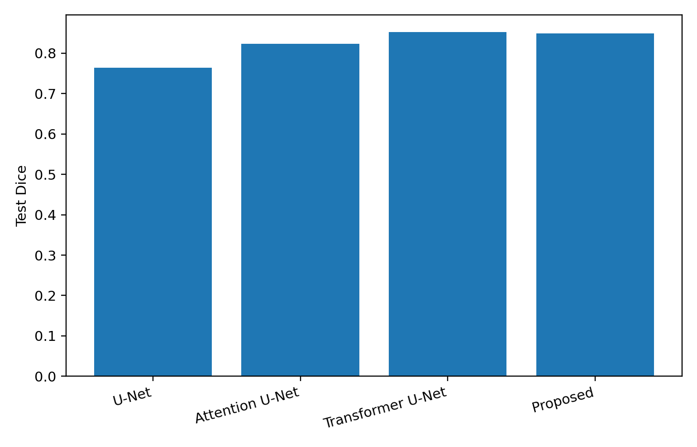
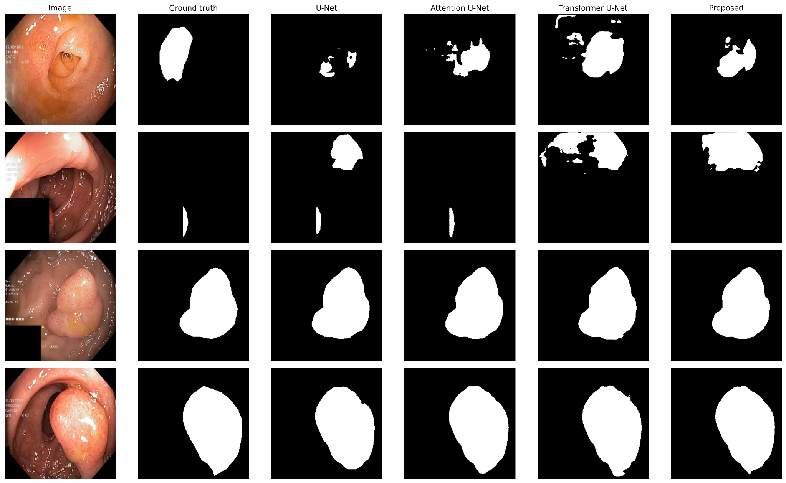

# Polyp Segmentation with U-Net and Transformers

## Extended-training result

The extended-training Transformer U-Net achieved **87.23% Dice**
and **80.42% IoU** on 150 held-out Kvasir-SEG images.

| Test metric | Result |
|---|---:|
| Dice | 87.23% |
| IoU | 80.42% |
| Precision | 89.24% |
| Recall | 90.32% |
| HD95 at 256×256 resolution | 25.93 pixels |

Training stopped at epoch 98; the best validation checkpoint was selected
at epoch 73. This is a single-seed result (seed 42).

The earlier architecture comparison is retained as historical evidence.
Identical splits between the historical and extended runs have not been
verified, so these scores do not establish a controlled improvement.

[Saved test metrics](results/transformer-extended-20261115-164954/metrics.json) ·
[Training configuration](results/transformer-extended-20261115-164954/config.json) ·
[Saved split](results/transformer-extended-20261115-164954/split.csv)


A PyTorch computer-vision project that identifies polyp regions in colonoscopy images. It compares four segmentation architectures and includes reproducible training, image-level evaluation, mask prediction, and visual overlays.

**Historical baseline result: 85.22% Dice and 77.66% IoU on 150 held-out Kvasir-SEG images**, using a Transformer U-Net trained from scratch with 11.97 million parameters.

## Project highlights

- Implemented U-Net, attention-gated U-Net, Transformer U-Net, and a combined architecture.
- Integrated a Transformer bottleneck to model spatial context within convolutional features.
- Built paired image/mask augmentation, mixed-precision training, and validation-based checkpoint selection.
- Compared segmentation quality, boundary distance, parameter count, and inference speed.
- Added automated tests, split checks, and safeguards against overwriting experiments.

**Stack:** Python · PyTorch · OpenCV · NumPy · SciPy · Matplotlib · pytest

## Recorded results

These are the existing baseline results from [the saved metrics](results/summary.csv), not results from the new extended-training configuration.

| Model | Dice | IoU | Recall | Parameters | ms/image* |
|---|---:|---:|---:|---:|---:|
| U-Net | 76.35% | 66.60% | 77.09% | 7.76M | 0.97 |
| Attention U-Net | 82.31% | 73.89% | 83.00% | 7.85M | 1.66 |
| **Transformer U-Net** | **85.22%** | **77.66%** | 86.47% | 11.97M | 1.66 |
| Attention + Transformer U-Net | 84.84% | 76.84% | **86.93%** | 12.06M | 2.67 |

Transformer U-Net achieved the highest Dice and IoU. Combining attention gates with the Transformer increased recall but did not improve overlap and added computation.

*Forward-pass time averaged per image in batches of four on an RTX 4090 at 256×256 resolution, excluding preprocessing. This is not single-image end-to-end latency. Metrics are averages across images. Each architecture has one recorded seed (42); per-image standard deviations do not measure variability across training runs.*



## Segmentation examples



The combined architecture is labeled “Proposed” in legacy result files and figures.

## Setup

Use Python 3.10 or 3.11. Install a PyTorch build suitable for your machine, then:

```bash
python -m pip install -r requirements.txt
python -m pytest -q tests
```

Download Kvasir-SEG from the [official dataset website](https://datasets.simula.no/kvasir-seg/) and arrange it as:

```text
data/Kvasir-SEG/
  images/
  masks/
```

The baseline uses 700 training, 150 validation, and 150 test images. Reuse the original `splits/kvasir_seed42.csv` when comparing with existing runs. Training creates a deterministic split only if it is absent; evaluation requires an existing split. Dataset files and trained weights are not included.

## Train

Run commands from the repository root. Baseline Transformer U-Net:

```bash
python train.py --config configs/transformer_unet.yaml --output runs/transformer_baseline_new
```

Candidate for improving validation performance:

```bash
python train.py --config configs/transformer_unet_extended.yaml --output runs/transformer_extended_new
```

The candidate keeps the architecture, split, resolution, and batch size fixed. It allows 100 epochs, uses five warmup epochs followed by cosine decay, clips gradients, and waits 25 epochs without validation improvement before stopping. This is an experiment, not a verified accuracy improvement. The updated loss computes Dice reductions in float32 to avoid half-precision overflow.

Use a new output directory for each experiment. History, checkpoints, and a copy of the split are saved there. `--data-root /path/to/Kvasir-SEG` overrides the dataset location; `--device cpu` enables CPU execution. Existing checkpoint formats remain supported.

## Validate and evaluate

Compare original and candidate checkpoints on validation data before selecting a configuration:

```bash
python evaluate.py --checkpoint runs/transformer_extended_new/checkpoints/best.pt --split val
```

Validation results go into the run's `validation/` directory. Once configuration selection is complete, explicitly evaluate the held-out test set:

```bash
python evaluate.py --checkpoint runs/transformer_extended_new/checkpoints/best.pt --split test
```

Test results go into `metrics.json` and `per_image_metrics.csv` in the run directory. Do not tune training settings on test scores. Keep new results separate from the baseline table until measured and verified. The batch experiment runner requires `--final-test` because it evaluates the held-out split.

## Predict a mask and overlay

```bash
python predict.py --checkpoint runs/transformer_extended_new/checkpoints/best.pt --image path/to/image.jpg --output predictions/mask.png
```

This saves a binary mask at the original image dimensions and a red overlay beside it.

## Project layout

```text
configs/       Baseline and candidate settings
datasets/      Paired loading, augmentation, and splits
models/        U-Net, attention gates, and Transformer bottleneck
utils/         Losses, metrics, training, and checkpoint utilities
tests/         Model, metric, and training-safety checks
results/       Existing measured benchmark results
docs/          Experiment protocol and example figures
train.py       Training and validation checkpoint selection
evaluate.py    Validation or explicit held-out evaluation
predict.py     Single-image mask and overlay export
```

## Scope and limitations

This portfolio project is not a clinical diagnostic system. Evaluation covers one dataset and one seed per baseline. External-dataset generalization and variability across seeds remain unmeasured. More training may or may not outperform the existing baseline; select new experiments using validation results.

## License and dataset credit

Code is available under the [MIT license](LICENSE). Kvasir-SEG is provided by its dataset creators; follow the [official terms and attribution instructions](https://datasets.simula.no/kvasir-seg/). The code license does not grant rights to redistribute the dataset.
