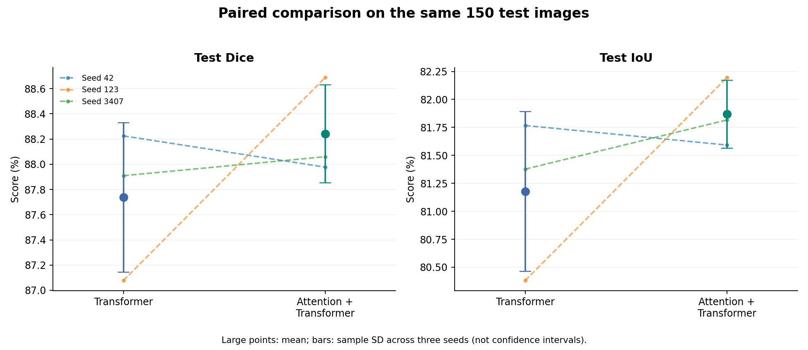
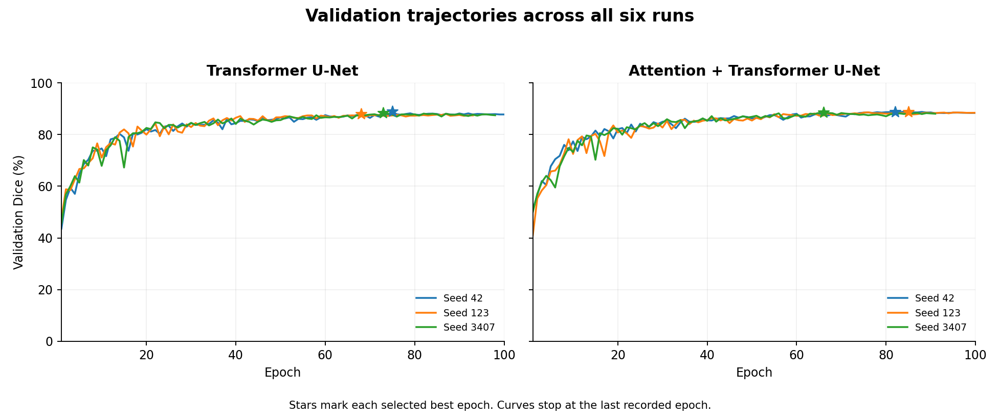
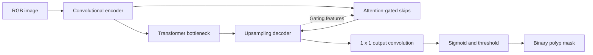
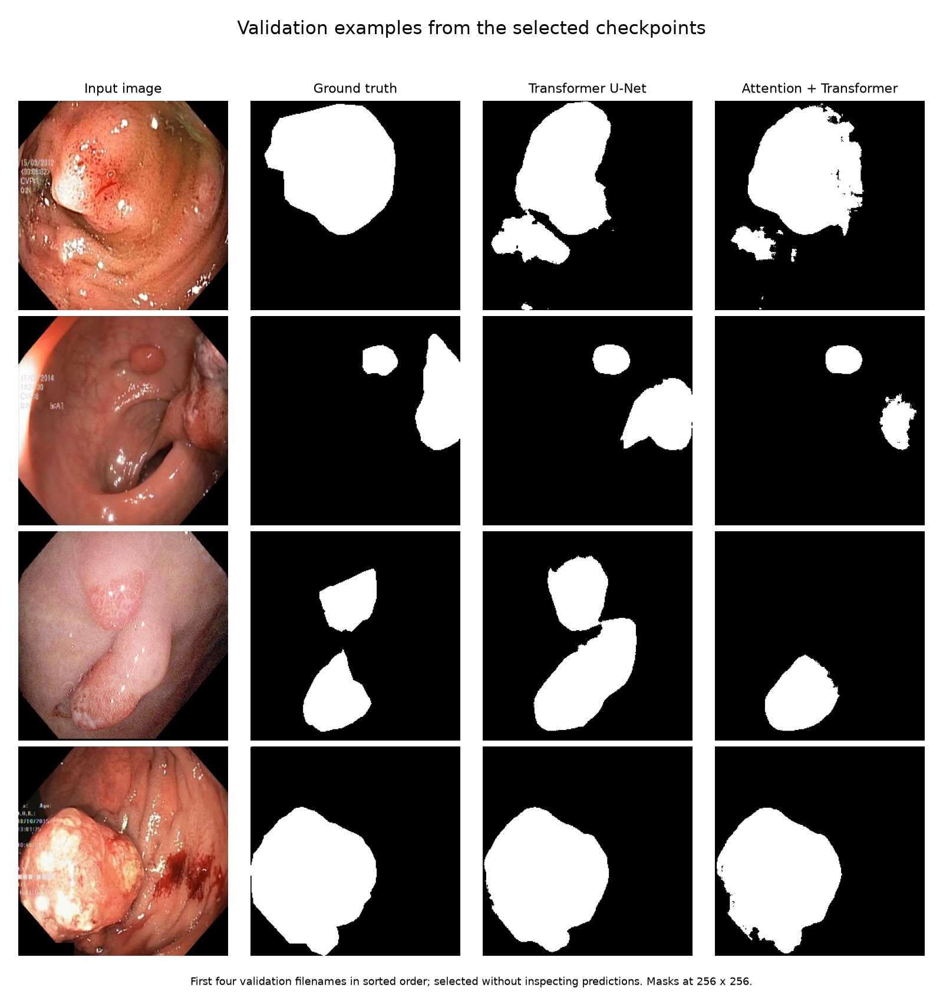
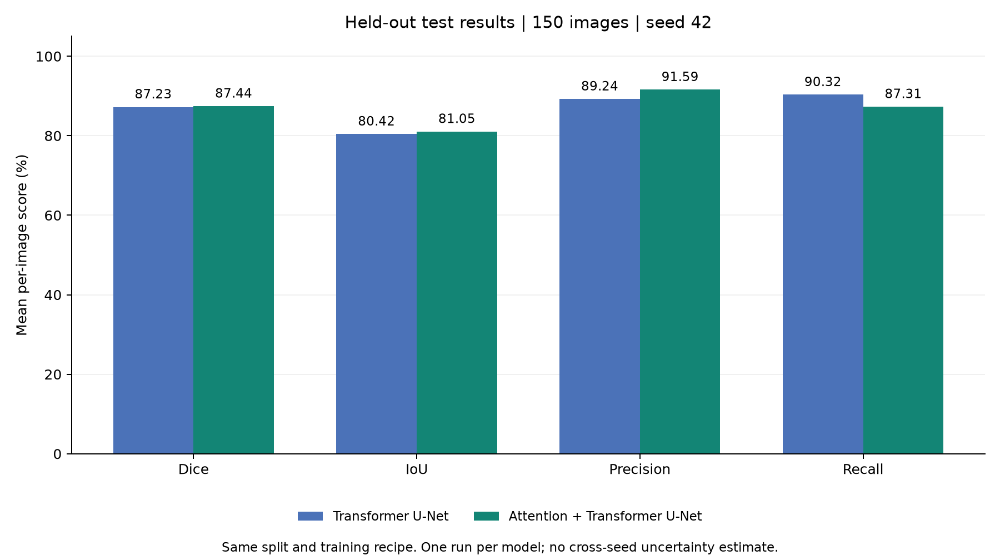
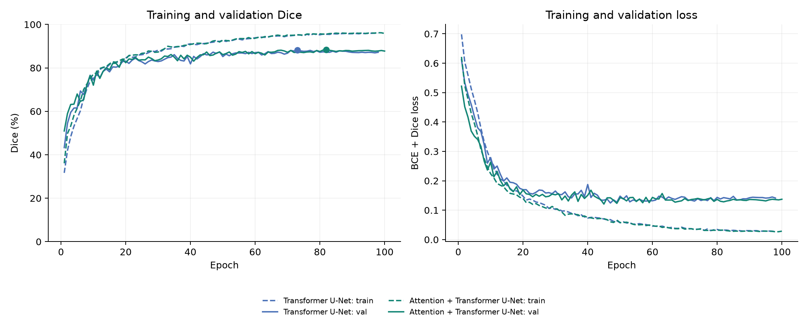

# Attention + Transformer U-Net for Polyp Segmentation

[](https://github.com/hammiroussama/lightweight-transformer-unet-kvasir/actions/workflows/tests.yml)
[](LICENSE)

Pixel-level polyp segmentation with a convolutional encoder–decoder, attention-gated skip connections, and a Transformer bottleneck. Built in PyTorch with reproducible training, image-level evaluation, and mask overlays.

**88.24% mean test Dice · 81.87% mean test IoU · 12.06M parameters**

Three paired training seeds on the same 150-image Kvasir-SEG test split.

[Results](#results) · [Architecture](#architecture) · [Quick start](#quick-start) · [Reproducibility](#reproducibility) · [Experiment history](#experiment-history)

## What this project demonstrates

- **Model implementation:** four U-Net variants built from shared convolution, attention, and Transformer components.
- **Controlled evaluation:** a matched two-model, three-seed study with validation-selected checkpoints and all six test results reported.
- **Engineering:** mixed-precision training, early stopping, saved splits, checkpoint protection, automated tests, and auditable result files.
- **Inference:** a command-line tool that exports a binary segmentation mask and an overlay at the original image size.

**Stack:** Python · PyTorch · OpenCV · NumPy · SciPy · Matplotlib · pytest

## Results

The latest study compares Transformer U-Net with Attention + Transformer U-Net using seeds **42, 123, and 3407**. Both use the same **700/150/150 train/validation/test split**, training recipe, and 256 × 256 inputs. Each run contributes its checkpoint with the highest validation Dice.

| Test metric | Transformer U-Net | Attention + Transformer U-Net |
|---|---:|---:|
| Dice (%) ↑ | 87.74 ± 0.59 | **88.24 ± 0.39** |
| IoU (%) ↑ | 81.18 ± 0.71 | **81.87 ± 0.30** |
| Precision (%) ↑ | 91.23 ± 0.23 | **91.77 ± 0.47** |
| Recall (%) ↑ | 88.32 ± 1.23 | **88.69 ± 0.52** |
| HD95 (pixels) ↓ | 24.30 ± 1.04 | **23.85 ± 1.01** |
| Forward time (ms/image) ↓ | **1.25 ± 0.01** | 2.38 ± 0.01 |
| Parameters | **11,974,241** | 12,062,485 |

Scores are **mean ± sample standard deviation across three training seeds**. Each run first averages metrics across 150 test images. These are training repetitions on one fixed split, not independent datasets; the error bars are not confidence intervals.

The combined model improves average Dice by **0.50 percentage points** and IoU by **0.69 points**, winning on two of three seeds. This modest gain costs approximately **1.9× the measured forward time**. Three seeds do not establish statistically significant or universal superiority.



<details>
<summary>Per-seed Dice scores and measurement details</summary>

| Seed | Transformer U-Net | Attention + Transformer U-Net | Difference (percentage points) |
|---|---:|---:|---:|
| 42 | 88.22% | 87.98% | −0.25 |
| 123 | 87.08% | 88.69% | +1.61 |
| 3407 | 87.91% | 88.06% | +0.15 |

Forward timing uses batches of four on an RTX 4090, with 10 warm-up passes and 50 timed passes. It excludes preprocessing and is not end-to-end application latency. HD95 is measured on masks resized to 256 × 256, not in physical units. Prediction threshold: 0.5.

Recorded environment: Python 3.11.17, PyTorch 2.5.1+cu121, CUDA runtime 12.1. The latest study uses strict deterministic algorithms and the math attention backend.

</details>

### Training behavior

The six validation curves below show checkpoint selection and variation across training seeds. Curves end when training stops; shorter runs are not padded with synthetic epochs.



## Architecture

The encoder extracts spatial features at four resolutions. At the deepest level, a two-layer Transformer processes **256 spatial tokens with 512 channels** for a 256 × 256 input. A depthwise convolution provides positional information. During decoding, attention gates filter each encoder skip connection before concatenation with the upsampled decoder features.



Shared components support U-Net, Attention U-Net, Transformer U-Net, and the combined architecture. The latest three-seed study isolates attention gates **within the Transformer U-Net pair**; it does not repeat the full four-model study. The configuration name `proposed` refers to Attention + Transformer U-Net.

See [model construction](models/unet.py) and [attention/Transformer blocks](models/blocks.py).

## Segmentation examples



These examples come from the **earlier single-seed extended runs**, not the new three-seed checkpoints. The first four validation filenames in sorted order were selected independently of model scores. They illustrate useful predictions and remaining errors; they are not additional test evidence. [Selection manifest](docs/images/extended_examples_manifest.json).

## Quick start

Run commands from the repository root. The recorded study used Python 3.11 and PyTorch 2.5.1. Install the PyTorch build appropriate for your CPU or CUDA environment, then the remaining dependencies:

```bash
git clone https://github.com/hammiroussama/lightweight-transformer-unet-kvasir.git
cd lightweight-transformer-unet-kvasir
python -m venv .venv
```

Activate with `source .venv/bin/activate` on Linux/macOS, or `.venv\Scripts\Activate.ps1` in Windows PowerShell.

```bash
python -m pip install -r requirements.txt
python -m pytest -q tests
python scripts/check_results.py
```

Unit tests and saved-result checks do not require the dataset, a GPU, or trained weights. Dependency ranges support installation; they are not a complete lockfile for the recorded server environment.

### Dataset

Obtain [Kvasir-SEG from the official source](https://datasets.simula.no/kvasir-seg/) and follow its usage and attribution terms. Extract it as:

```text
data/Kvasir-SEG/
├── images/
└── masks/
```

Image and mask filenames must match. The published study includes the exact split assignments; do not regenerate them when reproducing the comparison. Dataset files and trained checkpoints are **not distributed** in this repository.

### Train, validate, and predict

For a single development run, use the saved combined-model configuration and a new output directory:

```bash
python train.py --config results/seed-study-20261122-190743-088986/configs/proposed-seed42.json --output runs/combined_new --device cuda
python evaluate.py --checkpoint runs/combined_new/checkpoints/best.pt --split val --device cuda
python predict.py --checkpoint runs/combined_new/checkpoints/best.pt --image path/to/image.jpg --output predictions/mask.png --device cpu
```

Prediction creates `mask.png` and `mask_overlay.png` at the source image dimensions. Use your own trained checkpoint; this is not a pretrained download demo. Direct training uses the saved recipe but **does not enable the study runner's stricter attention settings**. Use the full study workflow below for the recorded execution policy.

Only after freezing the configuration, evaluate the test split:

```bash
python evaluate.py --checkpoint runs/combined_new/checkpoints/best.pt --split test --device cuda
```

## Reproducibility

The [experiment protocol](docs/EXPERIMENT_PROTOCOL.md) documents preprocessing, training, metric aggregation, deterministic evaluation, and test-set history.

To prepare a **new** six-run validation study:

```bash
python run_kvasir_seed_study.py --prepare --data-root data/Kvasir-SEG
```

The command prints a new study directory and its launch command. Check GPU availability, then use that new path with `--study` and your available GPU index. The runner freezes configurations and source hashes, executes jobs sequentially, and evaluates **validation only**. Do not reuse the published completed study directory to claim a new reproduction. Source fingerprints are tied to the preparation location and code; prepare again after moving the checkout.

To verify evidence and regenerate figures without training:

```bash
python scripts/check_results.py
python scripts/plot_seed_study.py
```

| Evidence | Location |
|---|---|
| Plan, fingerprints, configurations, and shared split | [Study directory](results/seed-study-20261122-190743-088986) |
| All six validation results | [Validation summary](results/seed-study-20261122-190743-088986/summary.json) |
| All six test results and checkpoint hashes | [Test summary](results/seed-study-20261122-190743-088986/test/summary.json) |
| Per-image test metrics and per-run metadata | [Test evidence](results/seed-study-20261122-190743-088986/test) |
| Machine-readable comparison | [Comparison CSV](results/seed-study-20261122-190743-088986/test/comparison.csv) |

## Experiment history

Earlier measurements remain available for transparency. They are separate experiments, not additional repetitions to pool into the latest mean.

<details>
<summary>Earlier extended training — one seed per model</summary>

Both models used identical split assignments and the same extended recipe, with seed 42. Transformer U-Net selected epoch 73 of 98; the combined model selected epoch 82 of 100. These runs preceded the stricter deterministic execution policy used in the three-seed study.

| Test metric | Transformer U-Net | Attention + Transformer U-Net |
|---|---:|---:|
| Dice | 87.23% | 87.44% |
| IoU | 80.42% | 81.05% |
| Precision | 89.24% | 91.59% |
| Recall | 90.32% | 87.31% |
| HD95 | 25.93 px | 25.16 px |
| Forward time | 0.82 ms/image | 1.91 ms/image |

The combined model improved overlap and precision but had lower recall and longer forward time. Historical timings are not interchangeable with the deterministic study timings.




[Transformer evidence](results/transformer-extended-20261115-164954) · [Combined-model evidence](results/attention-transformer-extended-20261116-200334)

</details>

<details>
<summary>Original four-architecture comparison — historical baseline</summary>

| Model | Test Dice | Test IoU |
|---|---:|---:|
| U-Net | 76.35% | 66.60% |
| Attention U-Net | 82.31% | 73.89% |
| Transformer U-Net | 85.22% | 77.66% |
| Attention + Transformer U-Net | 84.84% | 76.84% |

Transformer U-Net led this original experiment. The training recipe and loss implementation differ from later runs, and identical split assignments have not been verified against the extended study. These scores do not establish a controlled improvement over time. Historical per-image statistics are not seed variability or evidence of significance for the new study.

[Original metrics](results/summary.csv) · [Historical statistical comparisons](results/statistical_tests.csv)

</details>

## Repository structure

```text
configs/                  Development and historical experiment settings
datasets/                 Paired loading, augmentation, and split handling
models/                   Shared U-Net, attention, and Transformer components
utils/                    Training engine, losses, metrics, and checkpoints
tests/                    Model-shape, metric, and training-safety checks
scripts/                  Evidence checks, plots, and synthetic test data
results/                  Published measurements, histories, and frozen study inputs
docs/                     Experiment protocol and figures
train.py                  Train one configuration
evaluate.py               Evaluate a checkpoint on validation or test
predict.py                Export a mask and an overlay for one image
run_kvasir_seed_study.py   Prepare and run a paired three-seed validation study
```

`run_all_experiments.py` is the legacy four-model workflow, not the latest study runner. It can overwrite historical top-level result tables; use an isolated checkout when revisiting it. Generated datasets, checkpoints, logs, and prediction files are excluded from Git.

## Scope and limitations

The test split had already been inspected during earlier experiments. This is an exploratory engineering benchmark, not a fully blinded final evaluation. All three seeds share one dataset split; patient-level separation and external clinical generalization have not been established. Future changes should be selected on validation data and assessed on an untouched external dataset.

The combined architecture offers a small average overlap improvement with additional inference cost. This project is not a clinically validated diagnostic system.

## License and attribution

Code is available under the [MIT license](LICENSE). Kvasir-SEG is credited to Jha et al. (2020); consult the [official dataset source and citation](https://datasets.simula.no/kvasir-seg/) for usage terms. The code license does not grant dataset redistribution rights. [Software citation metadata](CITATION.cff) is included for reuse.
